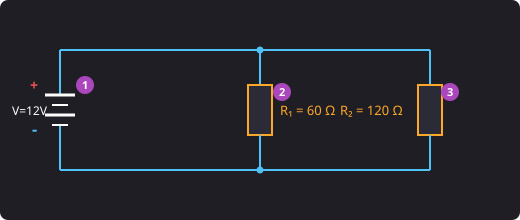
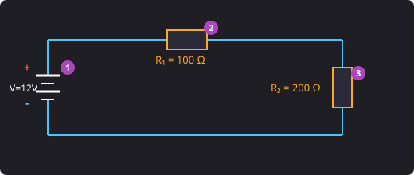

[← Volver al Índice de PACs](./index.md)

---

# PAC 2 (RA3) - Circuitos Eléctricos y Medidas

---

### Pregunta 1
Dos resistencias de 12 $\Omega$ están en paralelo. ¿Cuál es su resistencia equivalente?

  
A) 24 Ω

  

    
✗ Incorrecto

    24 $\Omega$ sería el resultado si estuvieran conectadas en serie ($12 + 12 = 24\ \Omega$).
  

  
B) 6 Ω

  

    
✓ ¡Exacto!

    Para dos resistencias iguales conectadas en paralelo, el valor equivalente es la mitad de una de ellas:  
    $$R_T = \frac{R}{2} = \frac{12}{2} = 6\ \Omega$$
    O mediante la fórmula general:
    $$\frac{1}{R_T} = \frac{1}{12} + \frac{1}{12} = \frac{2}{12} \implies R_T = \frac{12}{2} = 6\ \Omega$$
  

  
C) 3 Ω

  

    
✗ Incorrecto

    3 $\Omega$ resultaría de tener cuatro resistencias de 12 $\Omega$ en paralelo.
  

  
D) 12 Ω

  

    
✗ Incorrecto

    La resistencia equivalente de un circuito en paralelo siempre es menor que la menor de las resistencias conectadas.
  

---

### Pregunta 2 (Desarrollo)
Una fuente de 12 V alimenta dos resistencias en paralelo: $R_1 = 60\ \Omega$ y $R_2 = 120\ \Omega$.

#### a) Esquema con las dos ramas e identificación de componentes:

<figure markdown="span" style="margin: 1.5em 0; text-align: center;">

<figcaption>Circuito eléctrico con dos resistencias en paralelo alimentadas a 12 V</figcaption>
</figure>

* **1:** Fuente de alimentación (V), suministra 12V de forma continua (CC).
* **2:** Resistencia $R_1$ con un valor de $60\ \Omega$.
* **3:** Resistencia $R_2$ con un valor de $120\ \Omega$.

#### b) Cálculo de la resistencia total (en paralelo):

$$\frac{1}{R_T} = \frac{1}{R_1} + \frac{1}{R_2} \implies \frac{1}{R_T} = \frac{1}{60} + \frac{1}{120}$$

$$\frac{1}{R_T} = \frac{1 \cdot 2}{60 \cdot 2} + \frac{1}{120} = \frac{2}{120} + \frac{1}{120} = \frac{3}{120}$$

$$R_T = \frac{120}{3} = \mathbf{40\ \Omega}$$

#### c) Cálculo de la intensidad total que suministra la fuente:

$$I_T = \frac{V}{R_T} = \frac{12\text{ V}}{40\ \Omega} = \mathbf{0{,}3\text{ A}}$$

#### d) Si se desconecta la rama de $R_1$, ¿podrá seguir circulando corriente por $R_2$?

> **Respuesta:** Sí, sigue circulando, ya que en un circuito en paralelo cada componente va por su cuenta y $R_2$ mantiene su propio circuito cerrado.

---

### Pregunta 3 (Desarrollo)
Una fuente de 12 V alimenta dos resistencias en serie: $R_1 = 100\ \Omega$ y $R_2 = 200\ \Omega$.

#### a) Esquema e identificación de la fuente y las resistencias:

<figure markdown="span" style="margin: 1.5em 0; text-align: center;">

<figcaption>Circuito eléctrico con dos resistencias en serie alimentadas a 12 V</figcaption>
</figure>

* **1:** Fuente de alimentación, proporciona tensión continua 12V.
* **2:** Resistencia $R_1$ de $100\ \Omega$.
* **3:** Resistencia $R_2$ de $200\ \Omega$.

#### b) Cálculo de la resistencia total (en serie):

$$R_T = R_1 + R_2 \implies R_T = 100\ \Omega + 200\ \Omega = \mathbf{300\ \Omega}$$

#### c) Cálculo de la intensidad total en amperios y miliamperios:

$$I_T = \frac{V}{R_T} \implies I_T = \frac{12\text{ V}}{300\ \Omega} = \mathbf{0{,}04\text{ A}}$$

$$I_T = 0{,}04\text{ A} \cdot 1000 = \mathbf{40\text{ mA}}$$

#### d) Si se desconecta una resistencia y el circuito queda abierto, ¿seguirá circulando corriente por la otra?

> **Respuesta:** No, no circularía ya que en los circuitos en serie solo existe un "camino" y al quedar abierto, se corta el paso de la corriente.
