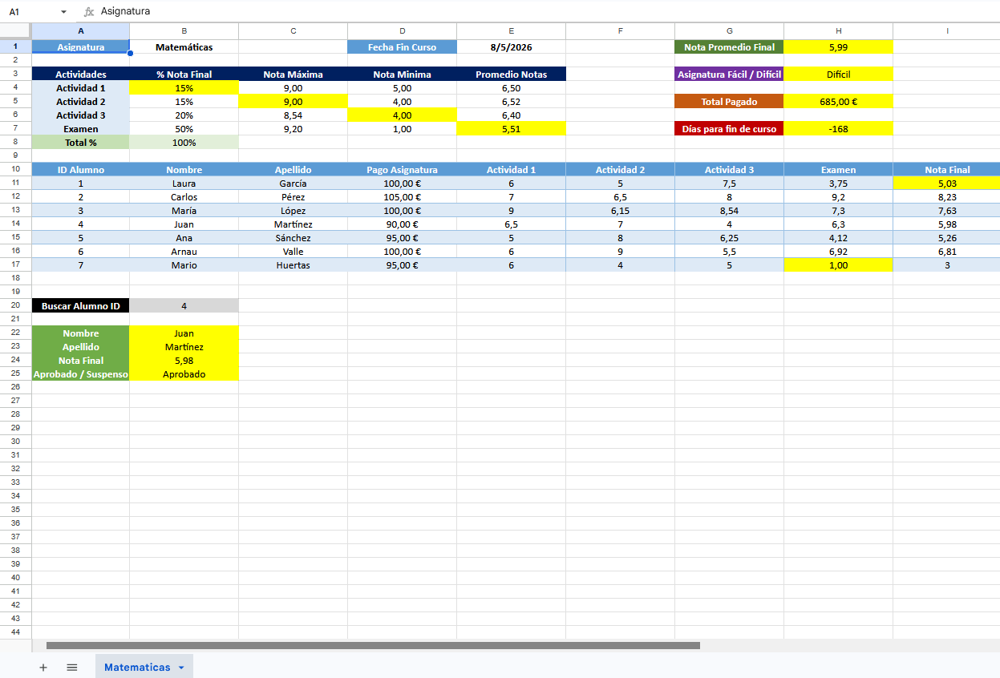

[← Volver al Índice de PACs](./index.md)

---

### Pregunta 1 (Enunciado y Hoja de Cálculo de Referencia)
Utiliza la siguiente hoja de cálculo de calificaciones y parámetros de la asignatura de Matemáticas para responder a las preguntas de esta actividad:

<figure markdown="span" style="margin: 1.5em 0; text-align: center;">
  { style="width: 100%; max-width: 950px; border-radius: 6px; box-shadow: 0 4px 10px rgba(0,0,0,0.3);" }
  <figcaption>Registro de calificaciones, ponderaciones y funciones de búsqueda</figcaption>
</figure>

---

### Pregunta 2
Para el alumno con ID 7, se necesita calcular la nota de examen en la celda H17 utilizando una fórmula. ¿Cuál de las siguientes fórmulas permite obtener la nota correcta del examen del alumno con ID 7 en la celda H17?

  
A) =(I17-E17*B4-F17*B5-G17*B6)/B7

  

    
✓ ¡Exacto!

    Despeja algebraicamente la nota de examen restando a la nota final ($I_{17}$) la aportación ponderada de las tres actividades ($E_{17} \cdot B_4$, $F_{17} \cdot B_5$, $G_{17} \cdot B_6$) y dividiendo el resultado restante entre el porcentaje que pondera el examen ($B_7$).
  

  
B) =(I17-E17*B4-F17*B5-G17*B6)/B5

  

    
✗ Incorrecto

    Divide entre $B_5$ (porcentaje de la Actividad 2) en lugar de hacerlo entre el peso del examen ($B_7$).
  

  
C) =(I17-E17*B6-F17*B6-G17*B6)/B7

  

    
✗ Incorrecto

    Multiplica todas las actividades erróneamente por la celda $B_6$, ignorando los porcentajes respectivos de las celdas $B_4$ y $B_5$.
  

  
D) =(I17-E17*0,2-F17*0,2-G17*0,2)/B6

  

    
✗ Incorrecto

    Aplica coeficientes numéricos fijos incorrectos en lugar de referenciar dinámicamente las celdas de ponderación de la tabla.
  

---

### Pregunta 3
Se necesita calcular con una fórmula la nota final del alumno con ID 1 en la celda I11. ¿Cuál de las siguientes fórmulas permite obtener la nota final del alumno con ID 1 en la celda I11?

  
A) =E11*B4+F11*B5+G11*B6+H11*B7

  

    
✓ ¡Exacto!

    Calcula la media ponderada sumando el producto de cada calificación individual ($E_{11}, F_{11}, G_{11}, H_{11}$) por su porcentaje correspondiente asignado en la cabecera ($B_4, B_5, B_6, B_7$).
  

  
B) =E11*0,15+F11*0,15+G11*0,15+H11*0,5

  

    
✗ Incorrecto

    Utiliza valores constantes hardcodeados y además asigna un 15% a la Actividad 3 cuando su ponderación real es del 20%.
  

  
C) =E11*B7+F11*B6+G11*B5+H11*B4

  

    
✗ Incorrecto

    Invierte el orden de multiplicación de las celdas de ponderación asignadas a cada columna de evaluación.
  

  
D) =(E11+F11+G11+H11)*B4

  

    
✗ Incorrecto

    Suma las cuatro notas y las multiplica en bloque únicamente por la celda $B_4$ (15%).
  

---

### Pregunta 4
Se necesita calcular el porcentaje de la Nota Final para la Actividad 1 en la celda B4. ¿Qué fórmula es la correcta para reflejar el cálculo en la celda B4?

  
A) =B8-B7-B6-B5

  

    
✓ ¡Exacto!

    Obtiene la ponderación de la Actividad 1 restando al total acumulado del 100% ($B_8$) el resto de porcentajes conocidos ($B_7, B_6, B_5$).
  

  
B) =B8-(B6+B5+B4)

  

    
✗ Incorrecto

    Incurre en referencia circular al incluir la propia celda $B_4$ dentro del cálculo y omite la celda del examen ($B_7$).
  

  
C) =100%-20%-50%-15%

  

    
✗ Incorrecto

    No aprovecha las referencias de celda de la hoja, restando flexibilidad si varían los porcentajes.
  

  
D) =RESTA(B8;B7;B6;B5)

  

    
✗ Incorrecto

    La función <code>RESTA</code> no existe con esa sintaxis en las hojas de cálculo estándar (se utiliza el operador aritmético <code>-</code> o <code>SUMA</code> con signos negativos).
  

---

### Pregunta 5
Escribe correctamente las funciones para obtener cada uno de los siguientes resultados:

#### 5.1. Nota máxima Actividad 2. Celda C5:

  Función: 
  <input type="text" class="quiz-input" data-ans="=MAX(F11:F17)" placeholder="Escribe aquí la función...">
  <button type="button" class="quiz-btn-confirm">Comprobar</button>
  

    
✓ ¡Correcto!

    La función <code>=MAX(F11:F17)</code> evalúa el rango de calificaciones de la columna F y devuelve el valor más alto (9,00).
  

#### 5.2. Nota mínima Actividad 3. Celda D6:

  Función: 
  <input type="text" class="quiz-input" data-ans="=MIN(G11:G17)" placeholder="Escribe aquí la función...">
  <button type="button" class="quiz-btn-confirm">Comprobar</button>
  

    
✓ ¡Correcto!

    La función <code>=MIN(G11:G17)</code> calcula el valor numérico mínimo contenido en el rango de notas de la columna G (4,00).
  

#### 5.3. Promedio Notas Examen. Celda E7:

  Función: 
  <input type="text" class="quiz-input" data-ans="=PROMEDIO(H11:H17)" placeholder="Escribe aquí la función...">
  <button type="button" class="quiz-btn-confirm">Comprobar</button>
  

    
✓ ¡Correcto!

    La función <code>=PROMEDIO(H11:H17)</code> calcula la media aritmética de todas las calificaciones de examen de la columna H (5,51).
  

---

### Pregunta 6
Escribe correctamente las funciones para obtener cada uno de los siguientes resultados:

#### 6.1. Nota Promedio Nota Final de la Asignatura. Celda H1:

  Función: 
  <input type="text" class="quiz-input" data-ans="=PROMEDIO(I11:I17)" placeholder="Escribe aquí la función...">
  <button type="button" class="quiz-btn-confirm">Comprobar</button>
  

    
✓ ¡Correcto!

    La función <code>=PROMEDIO(I11:I17)</code> computa la media de las notas finales de la columna I, obteniendo el valor 5,99.
  

#### 6.2. Asignatura Fácil o Difícil según promedio. Celda H3 (aparece "Fácil" si es $\ge 6$, y "Difícil" si es $< 6$):

  Función: 
  <input type="text" class="quiz-input" data-ans='=SI(H1>=6;"Fácil";"Difícil")' placeholder="Escribe aquí la función...">
  <button type="button" class="quiz-btn-confirm">Comprobar</button>
  

    
✓ ¡Correcto!

    La estructura condicional <code>=SI(H1>=6;"Fácil";"Difícil")</code> evalúa la celda H1 y devuelve el texto correspondiente según el umbral.
  

#### 6.3. Total Pagado de la Asignatura. Celda H5:

  Función: 
  <input type="text" class="quiz-input" data-ans="=SUMA(D11:D17)" placeholder="Escribe aquí la función...">
  <button type="button" class="quiz-btn-confirm">Comprobar</button>
  

    
✓ ¡Correcto!

    La función <code>=SUMA(D11:D17)</code> agrega todos los importes abonados por los alumnos registrados en la columna D (685,00 €).
  

---

### Pregunta 7
Elige las funciones correctas para buscar los datos de los alumnos en función de las celdas que correspondan:

#### 7.1. Nombre del alumno según ID introducido en B20. Celda B22:

  
A) =BUSCARV(B20;A10:I17;2;FALSO)

  

    
✓ ¡Exacto!

    Busca el ID introducido en $B_{20}$ dentro de la primera columna de la matriz $A_{10}:I_{17}$ y devuelve el dato de la columna 2 (Nombre) mediante coincidencia exacta.
  

  
B) =BUSCARV(B20;A10:I17;1;FALSO)

  

    
✗ Incorrecto

    La columna 1 corresponde al ID de búsqueda, no al nombre del alumno.
  

  
C) =BUSCARV(B22;A10:I17;2;VERDADERO)

  

    
✗ Incorrecto

    Toma como criterio la propia celda $B_{22}$ y usa coincidencia aproximada.
  

#### 7.2. Apellido del alumno según ID introducido en B20. Celda B23:

  
A) =BUSCARV(B20;A10:I17;3;FALSO)

  

    
✓ ¡Exacto!

    Recupera el valor ubicado en la columna 3 (Apellido) de la tabla referenciada a partir del ID de la celda $B_{20}$.
  

  
B) =BUSCARV(B20;A10:I17;2;FALSO)

  

    
✗ Incorrecto

    El índice 2 devolvería el nombre de pila en lugar del apellido.
  

  
C) =BUSCARH(B20;A10:I17;3;FALSO)

  

    
✗ Incorrecto

    La disposición de los registros es vertical por filas, por lo que debe emplearse <code>BUSCARV</code> y no <code>BUSCARH</code>.
  

#### 7.3. Nota Final del alumno según ID introducido en B20. Celda B24:

  
A) =BUSCARV(B20;A10:I17;9;FALSO)

  

    
✓ ¡Exacto!

    Devuelve la calificación definitiva situada en la columna 9 (Nota Final) de la matriz de datos.
  

  
B) =BUSCARV(B20;A10:I17;8;FALSO)

  

    
✗ Incorrecto

    La columna 8 contiene la nota de examen ($H$), no la nota final definitiva ($I$).
  

  
C) =BUSCARV(B20;A10:I17;10;FALSO)

  

    
✗ Incorrecto

    El rango $A_{10}:I_{17}$ solo abarca 9 columnas; indicar 10 arrojaría un error de referencia <code>#¡REF!</code>.
  

---

### Pregunta 8
En la celda B25 queremos saber si un alumno está aprobado o suspenso. Escribe la función correcta en la que si la nota final de la celda B24 del alumno que buscamos es menor a 5 aparezca la palabra "Suspenso" y si la nota es mayor o igual a 5 aparezca la palabra "Aprobado":

  Función: 
  <input type="text" class="quiz-input" data-ans='=SI(B24<5;"Suspenso";"Aprobado")' placeholder="Escribe aquí la función...">
  <button type="button" class="quiz-btn-confirm">Comprobar</button>
  

    
✓ ¡Correcto!

    La fórmula lógica <code>=SI(B24<5;"Suspenso";"Aprobado")</code> comprueba la condición de corte en 5 y asigna el estado académico correspondiente.
  

---

### Pregunta 9
En la celda H7 queremos ver los días que faltan para finalizar el curso en formato numérico, sabiendo que la fecha de fin de curso la tenemos en la celda E1. Se quiere que cada vez que entremos a la hoja de cálculo podamos ver los días restantes. Escribe la fórmula que nos permite ver los días restantes según el día en que entremos a la hoja de cálculo:

  Fórmula: 
  <input type="text" class="quiz-input" data-ans="=E1-HOY()" placeholder="Escribe aquí la fórmula...">
  <button type="button" class="quiz-btn-confirm">Comprobar</button>
  

    
✓ ¡Correcto!

    La expresión <code>=E1-HOY()</code> efectúa la diferencia directa entre la fecha fija del evento ($E_1$) y la fecha actual devuelta dinámicamente por la función volátil <code>HOY()</code>.
  

---

### Pregunta 10
Elige las 3 afirmaciones correctas de acuerdo con la información de la hoja de cálculo:

<label class="quiz-multi-option correct">
<input type="checkbox" data-opt="A"> A) El alumno Mario Huertas tiene Suspenso en la asignatura

✓ ¡Correcta!

Mario Huertas (ID 7) tiene una nota final calculada de 3,00, situándose por debajo de 5 (Suspenso).

</label>
<label class="quiz-multi-option correct">
<input type="checkbox" data-opt="B"> B) El total pagado de la asignatura es de 685€

✓ ¡Correcta!

La suma de las matrículas de la columna D ($D_{11}:D_{17}$) reflejada en la celda H5 asciende a 685,00 €.

</label>
<label class="quiz-multi-option incorrect">
<input type="checkbox" data-opt="C"> C) La asignatura de Matemáticas es una asignatura fácil ya que el promedio de nota final de la asignatura es inferior a 6

✗ Incorrecta

La condición estipulada indica que si el promedio es inferior a 6 la asignatura se califica como "Difícil" (como muestra la celda H3).

</label>
<label class="quiz-multi-option incorrect">
<input type="checkbox" data-opt="D"> D) Si en la celda B20 introducimos el valor de ID 4, el apellido será Martínez con un 4 de nota final

✗ Incorrecta

El alumno Juan Martínez (ID 4) tiene una nota final de 5,98 (Aprobado), no un 4.

</label>
<label class="quiz-multi-option incorrect">
<input type="checkbox" data-opt="E"> E) El alumno Mario Huertas tiene Aprobado en la asignatura

✗ Incorrecta

Con una nota final de 3,00 su calificación es Suspenso.

</label>
<label class="quiz-multi-option incorrect">
<input type="checkbox" data-opt="F"> F) El promedio pagado de la asignatura es de 95€

✗ Incorrecta

El promedio de pago es de 97,86 € (685 € / 7 alumnos).

</label>
<label class="quiz-multi-option correct">
<input type="checkbox" data-opt="G"> G) Si a la alumna Laura García le ponemos un 3,75 en la nota de examen, la asignatura de matemáticas será Difícil

✓ ¡Correcta!

Con 3,75 en el examen de Laura García la nota final global de la asignatura da 5,99, lo que hace que la celda H3 marque "Difícil".

</label>

<button type="button" class="quiz-btn-confirm">Comprobar selección</button>

