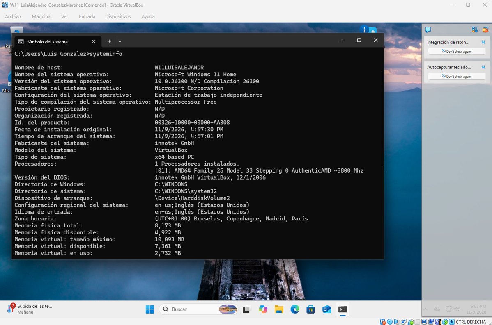
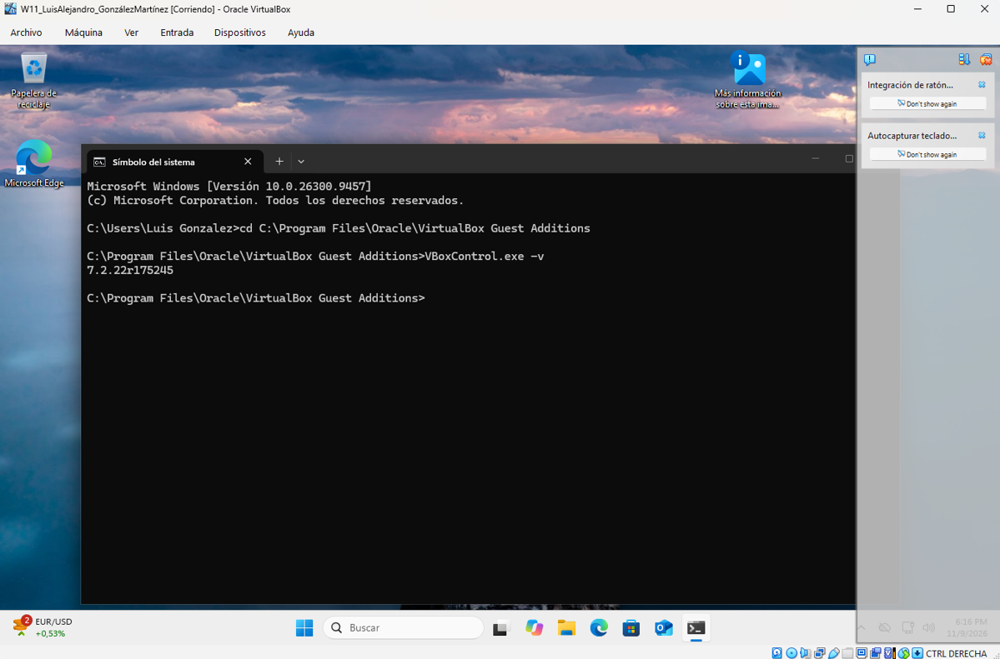

[← Volver al Índice de PACs](./index.md)

---

# PAC de Desarrollo - Instalación de Windows 11 y Guest Additions
**Sistemas Operativos Monopuesto**

---

### Requisitos y Parámetros de la Práctica

* **Hipervisor:** Oracle VirtualBox
* **Sistema operativo invitado:** Microsoft Windows 11 Home (64 bits)
* **Nombre de la máquina virtual:** `W11_LuisAlejandro_GonzálezMartínez`
* **Cuenta de usuario local configurada:** `Luis Gonzalez`

---

### Pregunta 1: Instalación de Windows 11

Instalación de Windows 11 en la máquina virtual cumpliendo con la nomenclatura requerida tanto en el hipervisor como en el sistema operativo. Para verificar la versión instalada y los parámetros de hardware asignados, se ejecuta el comando `systeminfo` en la terminal (Símbolo del sistema):

* **Nombre de host:** `W11LUISALEJANDR`
* **Nombre del SO:** `Microsoft Windows 11 Home`
* **Versión del SO:** `10.0.26300 N/D Compilación 26300`
* **Fabricante del sistema:** `innotek GmbH (VirtualBox)`
* **Memoria física total:** `8.173 MB` (8 GB asignados)

<figure markdown="span" style="margin: 1.5em 0; text-align: center;">



<figcaption>Escritorio anfitrión y ventana de la máquina virtual con la versión de Windows 11 en consola</figcaption>
</figure>

---

### Pregunta 2: Instalación de las Guest Additions

Tras completar la instalación base, se monta la imagen ISO de las herramientas de integración de VirtualBox (*Guest Additions*) y se ejecuta el asistente de instalación.

Una vez reiniciada la máquina virtual, se verifica la correcta integración de los controladores de pantalla, el redimensionamiento dinámico y la versión exacta de las utilidades ejecutando la herramienta de control por línea de comandos desde su directorio de instalación:

```cmd
cd C:\Program Files\Oracle\VirtualBox Guest Additions
VBoxControl.exe -v
```

* **Versión instalada:** `7.2.22r175245`

<figure markdown="span" style="margin: 1.5em 0; text-align: center;">



<figcaption>Comprobación de la versión de VirtualBox Guest Additions (7.2.22) en pantalla completa</figcaption>
</figure>
